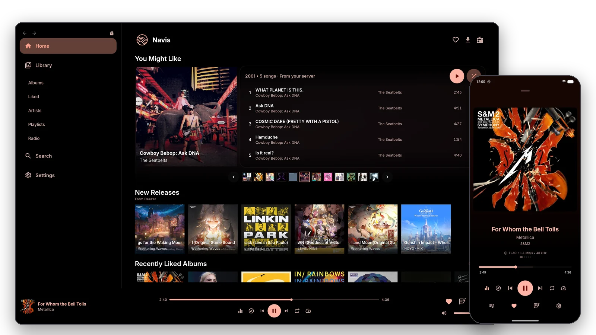
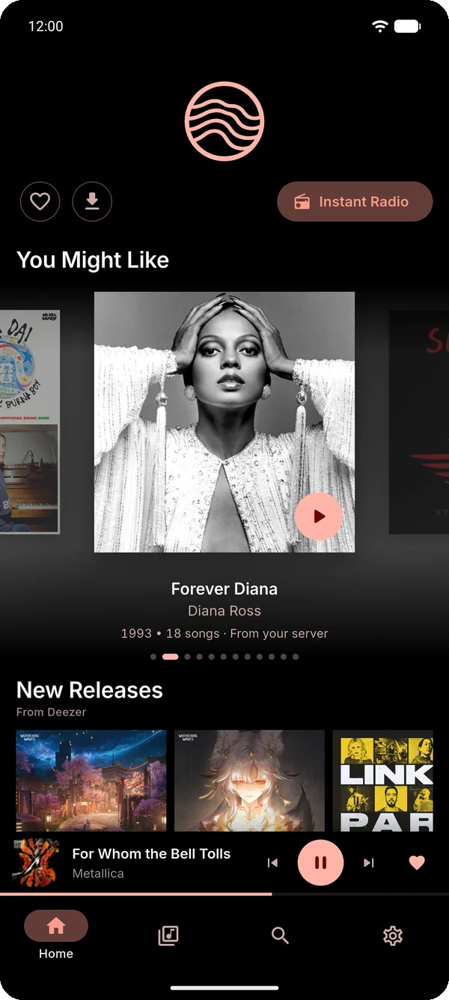
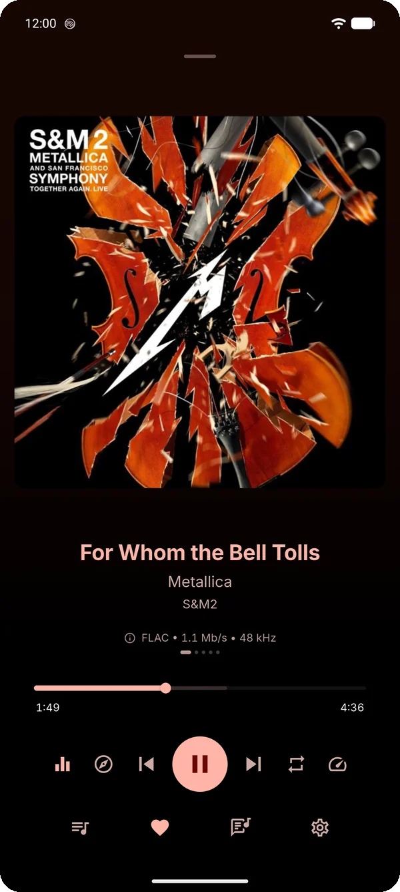
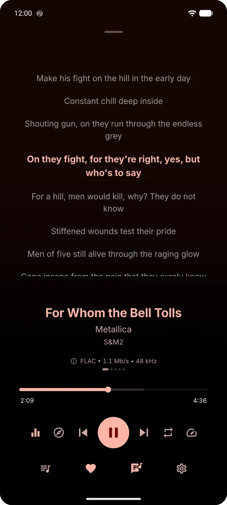
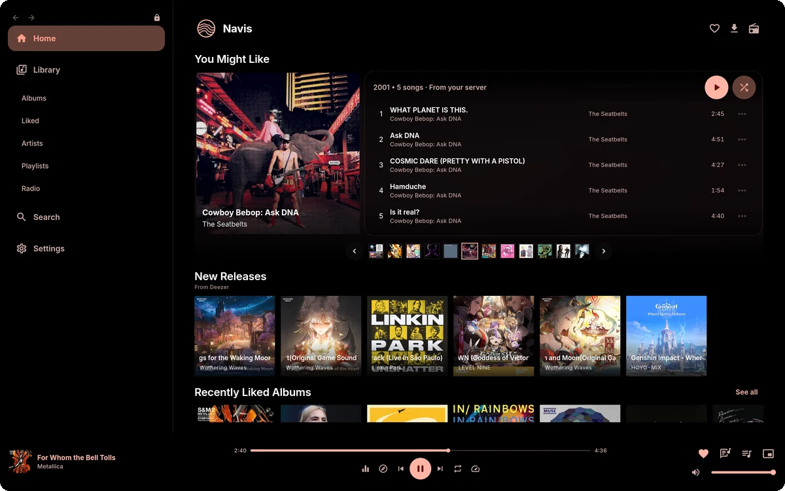
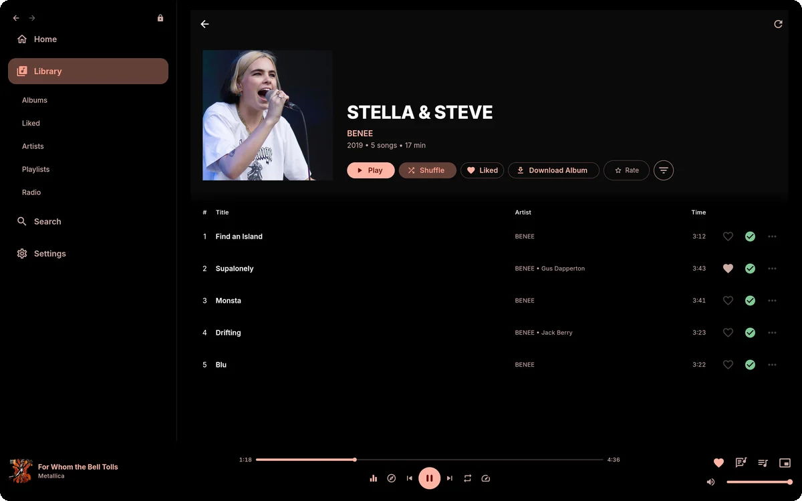
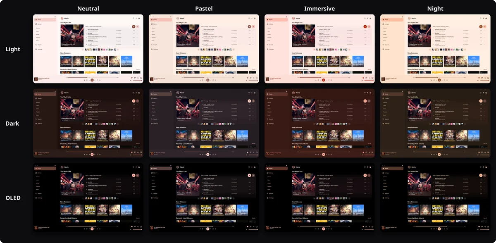

<div align="center">


# Navis

**A fast, offline-first music player for Navidrome and other Subsonic / OpenSubsonic servers.**

[](https://github.com/Porthorion/Navis/actions/workflows/ci.yml)
[](https://github.com/Porthorion/Navis/releases/latest)
[](LICENSE)
[](#download)
[](https://opensubsonic.netlify.app/)
[](https://github.com/Porthorion/Navis/stargazers)

[**Website**](https://navis.porthorion.com) · [**Download**](#download) · [**Screenshots**](#screenshots) · [**Report a bug**](https://github.com/Porthorion/Navis/issues/new/choose) · [**Contribute**](CONTRIBUTING.md)

<br>

<picture>
  <source media="(prefers-color-scheme: dark)" srcset="docs/assets/readme/hero-dark.webp">
  <source media="(prefers-color-scheme: light)" srcset="docs/assets/readme/hero-light.webp">
  
</picture>

</div>

## Why Navis

Navis connects straight to **your own music server**. There's no Navis account, no tracking and no cloud in between. It keeps your library on the device, so browsing is instant and playback keeps going when the network doesn't.

<table>
<tr>
<td width="50%" valign="top">

### 🎧 Playback done right
Gapless playback and crossfade, an **equalizer** (simple, 10-band or fully parametric) with AutoEQ headphone profiles, speed and pitch controls, ReplayGain, and synced lyrics.

### 📥 Offline first
Permanent downloads, a smart rolling cache and an offline mode. Your library stays browsable with no connection at all.

### 📻 Discover more
Personal Radio, Instant Mix, ListenBrainz **Weekly Jams & Exploration**, Deezer new releases and "This Is" playlists, all matched to songs on your server.

</td>
<td width="50%" valign="top">

### 🎨 Make it yours
Light, Dark and OLED, four **Color Styles**, colours taken from the album art, saved Looks, corner and density options, and Flat Surfaces.

### 🚗 Everywhere you listen
**Android Auto**, lock-screen and notification controls, Windows media controls, Linux MPRIS, desktop keyboard shortcuts and a Mini Player.

### 🔒 Private by design
Every online service has its own switch. Turn off *Online services* and Navis only ever talks to your server.

</td>
</tr>
</table>

## Screenshots

<div align="center">

&nbsp;
&nbsp;


<br><br>

&nbsp;


<br><br>



</div>

## Download

| Platform | Get it | Requirements |
|---|---|---|
| **Android** | [Website](https://navis.porthorion.com) · [GitHub Releases](https://github.com/Porthorion/Navis/releases/latest) | Android 7.0+. One universal APK, or per-architecture APKs |
| **Windows** | Installer from the [website](https://navis.porthorion.com) or [Releases](https://github.com/Porthorion/Navis/releases/latest) | Windows 10 / 11, x64 |
| **Linux** | `.deb`, `.rpm` or portable `.tar.gz` | x86_64, glibc 2.35+ (Ubuntu 22.04+, Debian 12+, Fedora). AUR coming soon |

Official downloads are served from Porthorion's Cloudflare R2 storage (`downloads.porthorion.com`). Each GitHub release carries identical copies plus a `SHA256SUMS` file, so you can check any download with `sha256sum -c SHA256SUMS`. Navis updates itself from a signed release manifest.

**Works with** [Navidrome](https://www.navidrome.org), the server Navis is developed and tested against, and other Subsonic / OpenSubsonic servers such as Gonic and Airsonic-Advanced. If your server misbehaves, please [tell us](https://github.com/Porthorion/Navis/issues/new?template=server_compatibility.yml).

## Build from source

You need Flutter 3.47.5+ (stable) and the toolchain for your platform: Android SDK, Linux desktop packages, or Visual Studio + Rust for Windows. Details are in the [development workflow](docs/development/development-workflow.md).

```bash
git clone https://github.com/Porthorion/Navis.git
cd Navis
./tool/bootstrap.sh   # once: checks Flutter and resolves dependencies
flutter run           # on a connected device or desktop
./tool/check.sh       # format, codegen, analysis, dead code and tests
```

## Contributing

Bug reports, ideas and pull requests are all welcome. Please read [CONTRIBUTING.md](CONTRIBUTING.md) first. Pull requests target `dev`, and `./tool/check.sh` must pass.

- 🐞 [Report a bug](https://github.com/Porthorion/Navis/issues/new?template=bug_report.yml)
- ✨ [Suggest an improvement](https://github.com/Porthorion/Navis/issues/new?template=enhancement.yml)
- 🔌 [Server compatibility problem](https://github.com/Porthorion/Navis/issues/new?template=server_compatibility.yml)
- 🔒 Security issues: report them privately, as described in [SECURITY.md](SECURITY.md)

If Navis is useful to you, a ⭐ helps other people find it.

## Documentation

- [Documentation index](docs/README.md): where everything lives
- [Technical overview](docs/development/technical-overview.md): platform status, media integrations and tech stack
- [Architecture](docs/architecture.md) · [Integrations and privacy](docs/features/integrations.md) · [Equalizer](docs/features/equalizer.md)
- [Release guides](docs/release/): Android/R2, Linux, Windows, macOS and secrets
- Contributors using AI agents: start with [AGENTS.md](AGENTS.md)

## License

Navis is free software published by [Porthorion](https://navis.porthorion.com) under the [GNU General Public License v3.0 or later](LICENSE). Third-party components keep their own licences, which are listed in the app under Settings › About › Open-source licenses. The Navis name and logo are not covered by the GPL; see [TRADEMARK.md](TRADEMARK.md).

Navis bundles the [Inter](https://github.com/rsms/inter) typeface under the SIL Open Font License 1.1 ([assets/fonts/OFL.txt](assets/fonts/OFL.txt)).
