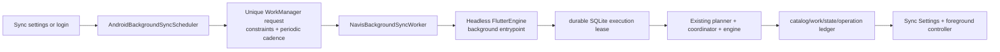

# Android Background Sync Recovery Plan

**Status:** implementation complete; physical-device certification pending
**Owner:** Navis library-sync architecture  
**Last reviewed:** 2026-08-12  
**Related:** [sync-reliability-recovery-plan.md](sync-reliability-recovery-plan.md)

## Decision

Implement Android automatic library sync with a native **WorkManager** bridge
that invokes a deliberately minimal, headless Dart sync entrypoint. Keep the
existing Dart planner, coordinator, durable work queue, candidate promotion,
cooldown, and operation ledger as the sole sync domain implementation.

Do **not** use an in-app `Timer`, an exact alarm, an implicit network receiver,
or a permanently running foreground service as the background scheduler.

WorkManager is the Android-recommended persistent scheduler for periodic data
sync. It survives normal process death and device reboot, applies network and
power constraints, and is explicitly intended for work that must complete
after the visible app exits. It is opportunistic, not an exact clock: periodic
work has a minimum 15-minute interval and may be delayed by Doze, quotas, or
other system constraints. [Android task scheduling](https://developer.android.com/develop/background-work/background-tasks/persistent), [periodic work requests](https://developer.android.com/develop/background-work/background-tasks/persistent/getting-started/define-work)

## Why Android currently fails

The current implementation provides only in-process scheduling:

1. `LibrarySyncController._onAppBackgrounded()` cancels the automatic timer.
2. `_armAutomaticCheckTimer()` immediately returns if the app is not
   foregrounded.
3. The Android module has no `androidx.work` dependency, `Worker`,
   `JobScheduler` job, or scheduler bridge.
4. The only declared foreground service is the existing media-playback service;
   it is unrelated to metadata sync.

Therefore “background sync” currently means *a sync that can continue while
the Flutter process happens to remain alive*. It does **not** mean Android can
launch Navis later, after it has been backgrounded or killed. Android 14 is
especially explicit that arbitrary work after an activity stops is unreliable;
framework schedulers such as WorkManager are the supported route. [Android 14
cached-app behavior](https://developer.android.com/about/versions/14/behavior-changes-all)

The recent sync-reliability work fixed duplicate foreground triggers, durable
deadlines, offline work persistence, and safe catalog writes. It intentionally
does not make the in-process timer an Android background executor.

## Product contract

| Situation | Required behavior |
| --- | --- |
| App visible | Existing controller owns automatic/manual/repair work. No native worker is started for the same run. |
| App backgrounded or process killed | WorkManager may start one bounded automatic pass when its constraints allow. |
| Wi-Fi/unmetered-only enabled | The native request requires `NetworkType.UNMETERED`; no broad download is started on cellular or metered Wi-Fi. |
| User permits background sync on metered data | The request requires `NetworkType.CONNECTED`; the Dart planner still applies byte budgets and durable policy. |
| Manual Check for updates | Runs immediately through the foreground controller. It is never silently converted to a periodic worker. |
| Repair Library | Never auto-resumed by WorkManager. It remains an explicit foreground, confirmation-aware action. |
| Active playback | The worker exits without broad work and records a safe defer reason. Playback never competes with a catalog write. |
| No authenticated session or unavailable secure credential | No network request. Record a redacted terminal reason and await the next app login. |
| User force-stops Navis | Do not promise a background run. Android will not resume app work until the user launches the app again. |

“Background” here is intentionally **eventual**, not “at precisely 10:00.” The
Settings UI must state the next requested cadence and the most recent platform
run/outcome, without claiming that Android guaranteed an exact execution time.

## Target architecture



### 1. Native scheduler, not a second sync implementation

Add a small Kotlin `AndroidBackgroundSyncScheduler` and a
`NavisBackgroundSyncWorker : CoroutineWorker` under
`android/app/src/main/kotlin/com/navis/app/navis/`.

- Add `androidx.work:work-runtime-ktx` and `androidx.work:work-testing` at a
  pinned current stable version compatible with the repository's Android Gradle
  Plugin and target SDK. Record the selected version in `AGENTS.md` and the
  Android dependency documentation when implementation begins.
- Expose only scheduling/cancellation/status over a narrow method channel:
  `configurePeriodic`, `enqueueCatchup`, `cancel`, and `status`.
- Use a server-profile-derived opaque hash as input and in the unique work
  name. Never pass a server URL, username, password, album, or song ID through
  WorkManager `Data`, notifications, logs, or diagnostics.
- On login, logout, server replacement, interval changes, and the metering
  preference changing, reconcile the native schedule. Logging out or replacing
  a server cancels its native work before credentials/catalog ownership change.

### 2. One unique periodic request per active profile

Use one named periodic request such as
`navis.library.automatic.<opaque-profile-key>.v1`.

- Interval: the selected 15/30/60/120/360/720 minutes. Manual-only (`0`)
  cancels it. Never try to emulate sub-15-minute execution.
- Constraints: `UNMETERED` when the existing setting is enabled; `CONNECTED`
  when the user explicitly permits metered background sync. Do not add
  charging/idle constraints by default because they can starve normal library
  discovery.
- Use `enqueueUniquePeriodicWork(..., UPDATE, request)` when the interval or
  constraints change. `UPDATE` avoids cancelling an already-running worker and
  preserves its enqueue timing; `REPLACE`/`CANCEL_AND_REENQUEUE` would recreate
  the scheduling race that this recovery is intended to remove. [Unique work
  API](https://developer.android.com/reference/androidx/work/WorkManager),
  [periodic UPDATE semantics](https://developer.android.com/reference/androidx/work/ExistingPeriodicWorkPolicy)
- The periodic worker asks the existing planner for an `automatic` catalog
  request. The planner may choose a cheap probe, resumable safe work, or a
  no-op. It must never select full repair automatically.

### 3. One unique catch-up request, only when useful

Use a separate named `OneTimeWorkRequest` only to promptly drain already
durable, eligible automatic work after a relevant local change (for example,
the user enables background sync or changes from metered to unmetered policy).

- Use a distinct unique name and `ExistingWorkPolicy.KEEP` so repeated
  connectivity/settings signals cannot enqueue a storm.
- Apply the same network constraint as periodic work.
- Do not use expedited work for normal catalog polling. It has quotas and is
  intended for user-important work that finishes in a few minutes.
- Do not chain catch-up work behind periodic work: the database lease is the
  cross-process source of serialization.

WorkManager offers named unique work specifically to keep one active instance
of a logical job, but that alone cannot serialize it with the foreground
Flutter controller. [Managing unique work](https://developer.android.com/develop/background-work/background-tasks/persistent/how-to/manage-work)

### 4. Headless Dart entrypoint

Do not start normal `main()` from a Worker: it bootstraps UI, audio, playback,
and presentation services that do not belong in a background metadata pass.

Add a retained, top-level Dart entrypoint such as:

```dart
@pragma('vm:entry-point')
Future<void> navisBackgroundSyncEntrypoint() async { /* no runApp */ }
```

The Worker creates a new `FlutterEngine` (prefer a `FlutterEngineGroup` when a
visible engine exists), registers plugins, starts that entrypoint, sends one
strictly typed `runAutomaticBackgroundSync` command, awaits one terminal result
with a timeout, and destroys its engine in `finally`.

The Dart entrypoint must:

1. call `WidgetsFlutterBinding.ensureInitialized()` but never `runApp()`;
2. create a minimal provider container containing only database, credentials,
   server configuration, network policy, API client, planner/coordinator, and
   network usage reporting;
3. load the active server through the normal repository and obtain credentials
   from the existing encrypted storage plugin—never from Worker input;
4. invoke the exact existing `LibrarySyncRequest.automatic` production path;
5. close the container/database and return only a redacted result code,
   counters, and timing to Kotlin.

Flutter supports independent engines and background Dart execution, but each
engine has independent plugin instances and state. That is why this design
requires plugin registration and a durable database lease rather than relying
on the foreground controller's in-memory `_inFlight` future. [FlutterEngine
API](https://api.flutter.dev/javadoc/io/flutter/embedding/engine/FlutterEngine.html),
[Flutter multi-engine guidance](https://docs.flutter.dev/add-to-app)

### 5. Cross-engine execution lease

Add a schema migration for `library_sync_execution_lease`:

| Field | Purpose |
| --- | --- |
| `server_id` (primary key) | One lease per retained profile. |
| `owner_token` | Random opaque worker/controller identity. |
| `owner_kind` | `foreground` or `androidWorker`; safe diagnostic category only. |
| `started_at`, `heartbeat_at` | Detect abandoned work after a killed process. |
| `expires_at` | Allows recovery after a bounded, conservative stale threshold. |

Acquire/renew/release this lease transactionally through `LibrarySyncDao`.
Every broad catalog execution path—foreground and Android Worker—must acquire
it before planning network work, heartbeat during long runs, and release in a
`finally` block. If another owner holds a fresh lease, the worker records
`leaseHeld` and returns success; its next scheduled opportunity can try again.
It must not run concurrently, spin retries, or steal a non-expired lease.

This is necessary because WorkManager uniqueness covers native work only,
whereas an active Flutter app and a headless Flutter engine can otherwise each
create their own in-memory coordinator.

### 6. One durable result model

Keep domain results in the existing sync tables and operation ledger. Add a
small Android execution record (either a dedicated per-server table or fields
on `library_sync_state`) containing only:

- last native schedule reconciliation time and requested cadence;
- latest WorkManager ID/state/attempt count;
- latest worker started/completed time and duration;
- redacted terminal category: `succeeded`, `noWorkDue`, `deferredPolicy`,
  `leaseHeld`, `credentialUnavailable`, `transientFailure`, `permanentFailure`,
  `stoppedBySystem`;
- safe WorkManager stop reason when available.

Settings should show “Android background sync” separately from the normal
catalog deadline: requested interval, last Android attempt, result/defer reason,
and whether Android is waiting for unmetered connectivity. It must never show
credentials, server identity, raw exceptions, or claim a future OS execution
time as guaranteed.

Use the same bounded redacted diagnostics policy as sync. Android WorkManager
can expose stop reasons and scheduling state; retain those safe categories so
quiet failures become actionable rather than invisible. [WorkManager
diagnostics guidance](https://developer.android.com/blog/posts/deeper-performance-considerations)

## Result and retry rules

| Outcome | Worker result | Durable state |
| --- | --- | --- |
| Planner succeeds, has no work, or safely defers | `success` | Store terminal category; retain coordinator's normal next deadline. |
| Another valid lease is active | `success` | `leaseHeld`; no retry loop. |
| Network constraint not met | WorkManager waits before starting | Show constraint/defer state when observed. |
| Normal transport failure handled by coordinator | `success` | Coordinator persists its own retry/circuit cooldown; do not create a second competing backoff. |
| Worker/engine bootstrap failure before coordinator owns the pass | bounded `retry` | Record safe bootstrap category; cap by WorkManager backoff and surface it. |
| Authentication/credential/schema invariant failure | `failure` or `success` after durable terminal record | Do not retry endlessly; require normal app recovery/login. |
| System stops long worker | let cancellation propagate | Preserve durable work/checkpoints and stop reason; next eligible schedule resumes safely. |

The critical rule is that WorkManager scheduling backoff cannot compete with
`library_sync_state.next_eligible_at`. The coordinator remains the single owner
of sync-domain retry/circuit policy; WorkManager retries only failures that
prevented reaching that owner at all.

## Foreground services, notifications, and battery policy

Normal automatic sync should use regular constrained WorkManager work. Do not
start a foreground service merely to make periodic metadata sync survive.

If a future **user-initiated**, clearly visible operation genuinely exceeds a
worker’s short execution budget, evaluate a foreground/long-running worker
separately, with a truthful notification and the correct Android foreground
service type. Android 12+ restricts starting foreground services from the
background, and Android 14+ requires valid service types; metadata sync is not
a justification to reuse the media-playback service. [Foreground-service
restrictions](https://developer.android.com/develop/background-work/services/fgs/restrictions-bg-start),
[Android 14 foreground-service requirements](https://developer.android.com/about/versions/14/behavior-changes-14)

Do not request battery-optimization exemption as a prerequisite for this
feature. WorkManager is designed to cooperate with Doze and system quotas.
Provide a support hint only after recorded, device-specific repeated stops,
never an automatic prompt.

## Delivery sequence

### Phase A — contracts and persistence

1. Add background-sync domain types, the execution lease DAO, Android execution
   status persistence, migrations, and migration tests.
2. Extract a non-UI sync bootstrap factory shared by foreground and headless
   execution. Prove it does not create audio handlers, player state, app shell,
   notifications, or diagnostics HTTP server.
3. Add deterministic DAO/coordinator tests for lease contention, expiry,
   release-on-error, credential absence, and worker result mapping.

### Phase B — native scheduling

1. Add WorkManager dependencies and Kotlin scheduler/worker classes.
2. Implement schedule reconciliation on signed-in session changes and Settings
   changes, using unique periodic `UPDATE` and unique one-time `KEEP`.
3. Add a narrow Android method-channel contract plus unit tests for generated
   interval, network constraint, opaque name, cancellation, and error mapping.
4. Add a debug-only, authenticated app-owned diagnostic observation endpoint;
   it may report redacted native schedule/state but must not schedule work or
   expose sensitive WorkManager input.

### Phase C — headless execution

1. Add the retained Dart entrypoint and strict Worker-to-Dart command/result
   protocol.
2. Register required plugins on the worker engine, including encrypted
   credential storage and path/database support.
3. Wire cancellation from `CoroutineWorker` to Dart/coordinator cancellation,
   then wait for durable checkpoint completion before engine teardown.
4. Enforce the cross-engine lease in every broad execution path.

### Phase D — UI and rollout

1. Present the Android execution status in Sync Settings and the existing
   redacted diagnostics surface.
2. Gate the capability behind a durable Android-only feature flag, default off
   for the first internal build. Preserve current foreground behavior while it
   is off.
3. Enable for internal testers, inspect stop reasons/attempt categories, then
   enable by default only after the physical-device matrix passes.

## Required validation

### Implementation status (2026-08-12)

Phases A–D are implemented behind the durable Android-only internal feature
flag (`NAVIS_ENABLE_ANDROID_BACKGROUND_SYNC=true`): schema v65 adds the
cross-engine lease and redacted execution status; the Android module uses
WorkManager 2.11.2; the Worker launches the retained headless Dart entrypoint;
and Sync Settings renders the requested cadence and latest safe outcome.
Focused Dart/DAO/widget tests and Android scheduler unit tests pass. The
physical-device matrix below remains mandatory before the flag is enabled by
default. The shared `LibrarySyncExecutionBootstrap` now constructs both
foreground and headless production sync pipelines; the headless command also
validates its opaque profile key against the active retained profile before it
can make a request.

Static tests do not prove Android background behavior. Every implementation
iteration must include Linux startup smoke plus Android device validation using
the Android scheduler as the authoritative platform API.

| Scenario | Required evidence |
| --- | --- |
| Schedule creation/update | Android unit test and `WorkManager` test driver assert one named periodic request, correct interval, `UPDATE`, and network constraint. |
| Constraint wait | Test driver holds/releases constraints; device `dumpsys jobscheduler` shows the job’s unmet network condition. |
| App swiped away | Physical device: schedule, leave the app, let WorkManager run, reopen; authenticated app API proves the durable terminal record and local catalog effect. |
| Process death | Kill only Navis’s process, allow the scheduled worker, reopen and assert ledger/state/checkpoints. Do not confuse this with user force-stop. |
| Reboot | Schedule then reboot a test device; verify WorkManager reschedules and one eligible pass completes. |
| Foreground overlap | Begin a foreground sync, trigger worker, prove exactly one lease owner and no duplicate endpoint calls/catalog mutation. |
| Metered Wi-Fi/cellular | Verify `UNMETERED` worker does not run; allow the explicit setting and verify bounded `CONNECTED` behavior. |
| Playback and repair | Verify background worker defers during playback and never resumes a pending repair. |
| Cancellation/system stop | Force a test stop reason; prove durable work/checkpoints survive and the next attempt is bounded. |
| Visual handoff | On reopening, capture and inspect Sync Settings through the app-owned screenshot API; it must show the native attempt/defer/outcome and no clipping. |

Use WorkManager’s test driver for deterministic constraints/delay/stop cases,
and Android Studio Background Task Inspector plus `adb shell dumpsys
jobscheduler` for device diagnosis. [WorkManager TestDriver](https://developer.android.com/reference/androidx/work/testing/TestDriver), [Background Task Inspector guidance](https://developer.android.com/blog/posts/deeper-performance-considerations)

## Acceptance criteria

The Android background-sync issue is fixed only when all are true:

1. A signed-in Android device has one durable, correctly constrained native
   schedule per active server profile.
2. A normal app background/process-death path can complete one safe automatic
   pass without reopening Navis first.
3. The worker never duplicates a foreground run, resumes a repair, bypasses
   candidate confirmation, or mutates the catalog without the same operation
   ledger guarantees as foreground sync.
4. Metered restrictions, secure credential unavailability, system stops, and
   authentication failures are visible as safe durable categories—not silent
   failures.
5. Physical-device tests cover at least Android 12, Android 14, and the
   current target-SDK device image; the app API, native scheduler state,
   persisted effects, logs, and inspected Settings screenshot agree.

## Explicit limitations

- WorkManager provides reliable **eventual** scheduling, not exact cadence.
- OEM battery managers can delay work; capture stop reasons and constraints
  rather than pretending every delay is an app failure.
- A user force-stop is a deliberate platform stop and is outside the guarantee
  until the user opens Navis again.
- This plan is Android-only. iOS background refresh needs a separately designed
  native lifecycle and must not be inferred from WorkManager.
